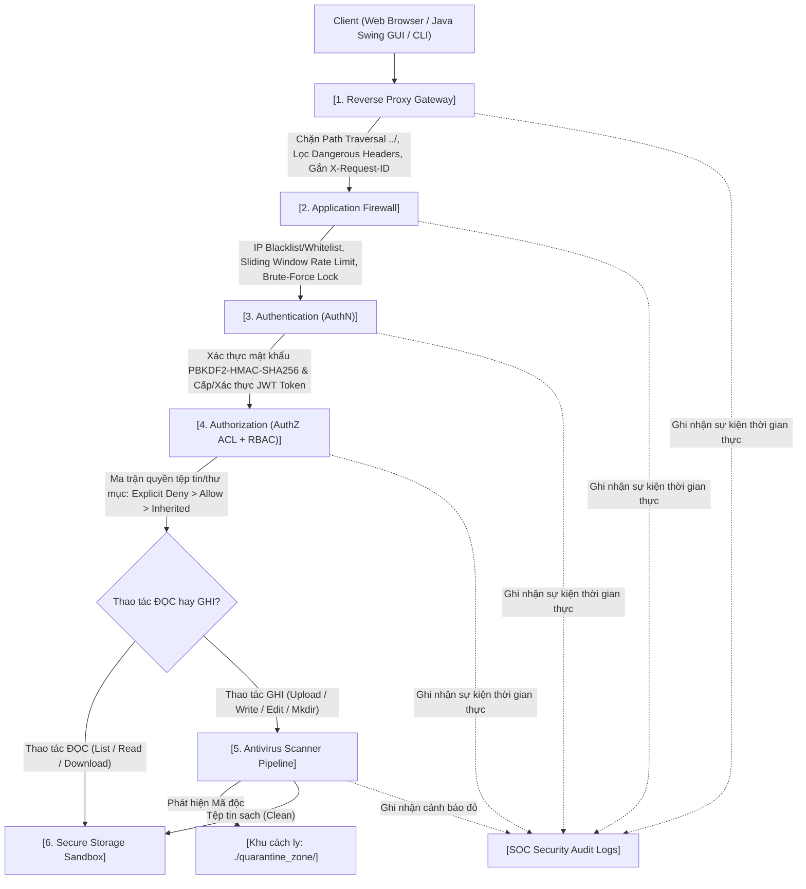

# ĐỒ ÁN MÔN HỌC: LẬP TRÌNH MẠNG / AN NINH MẠNG (NETWORK SECURITY)

## ĐỀ TÀI: HỆ THỐNG QUẢN LÝ TRUY CẬP TỆP TIN TỪ XA VỚI XÁC THỰC VÀ ỦY QUYỀN (REMOTE FILE ACCESS MANAGEMENT SYSTEM WITH AUTHENTICATION & AUTHORIZATION)
### TÍCH HỢP 3 LỚP BẢO MẬT MẠNG: REVERSE PROXY, FIREWALL VÀ ANTIVIRUS SCANNERS

---

## 1. TỔNG QUAN KIẾN TRÚC DEFENSE-IN-DEPTH (PHÒNG THỦ THEO CHIỀU SÂU)

Mọi yêu cầu (Request) từ Client đến File Server vật lý bắt buộc phải đi qua chuỗi kiểm soát an ninh nghiêm ngặt theo đúng thứ tự 6 chặng:



---

## 2. CẤU TRÚC THƯ MỤC DỰ ÁN (NETBEANS & FULL-STACK)

```
D:\ThucHanhLTM\DACK_LTM\
├── src/
│   └── dack_ltm/
│       ├── DACK_LTM.java               # [File chính mở trong NetBeans] Khởi chạy Server & Swing GUI
│       ├── config/
│       │   └── SystemConfig.java       # Tham số an ninh, cổng 8080, danh sách đuôi cấm, EICAR
│       ├── models/
│       │   ├── User.java               # Model người dùng & vai trò (ADMIN, USER, GUEST)
│       │   ├── FilePermission.java     # Model ma trận quyền ACL (read, write, delete, isDeny)
│       │   ├── FirewallRule.java       # Model quy tắc lọc IP Firewall
│       │   ├── AuditLog.java           # Model nhật ký an ninh kiểm toán SOC
│       │   └── QuarantineRecord.java   # Model hồ sơ tệp tin cách ly mã độc
│       ├── database/
│       │   └── JsonDataStore.java      # Cơ sở dữ liệu tự khởi tạo (Auto-seeding) không phụ thuộc thư viện ngoài
│       ├── security/
│       │   ├── CryptoUtils.java        # Băm mật khẩu chuẩn PBKDF2-HMAC-SHA256, SHA-256
│       │   ├── JwtManager.java         # Tạo và xác thực JWT token, quản lý Token Blacklist khi Logout
│       │   ├── ProxyGateway.java       # Tầng 1: Reverse Proxy, lọc header, triệt tiêu Path Traversal
│       │   ├── FirewallEngine.java     # Tầng 2: Firewall lọc IP, Rate Limiting, chống Brute-force
│       │   ├── AntivirusScanner.java   # Tầng 5: Quét mã độc 4 bước & cách ly vào Quarantine Vault
│       │   └── AclEngine.java          # Tầng 4: Bộ máy ủy quyền ma trận quyền chi tiết (RBAC + ACL)
│       ├── storage/
│       │   └── SecureFileService.java  # Quản lý kho tệp tin bảo mật, kiểm tra quyền Đọc/Ghi thực tế
│       ├── server/
│       │   └── EmbeddedHttpServer.java # Web Server & REST API Gateway (chạy trên cổng 8080)
│       └── ui/
│           └── MainSocDashboard.java   # Giao diện Desktop Java Swing Cyber SOC đầy đủ tính năng
├── templates/
│   └── index.html                     # Giao diện Web Cyber Dashboard (Tailwind CSS + FontAwesome)
├── static/
│   ├── css/style.css                  # Giao diện phong cách SOC tối ưu
│   └── js/
│       ├── api.js                     # API Client cho giao diện Web
│       └── app.js                     # Xử lý tương tác Frontend thời gian thực
├── secure_storage/                    # Kho lưu trữ tệp tin vật lý (được bảo vệ)
│   ├── projects/                      # Thư mục dự án (Alice có quyền R/W, Bob chỉ đọc)
│   ├── company_policies/              # Thư mục quy định công ty (Alice & Bob chỉ đọc)
│   └── hr_confidential/               # Thư mục nhân sự tuyệt mật (Cấm tuyệt đối Alice & Bob)
├── quarantine_zone/                   # Khu cách ly mã độc được cô lập vật lý
├── cli_client.py                      # CLI Client & Kịch bản tự động kiểm thử 5 kịch bản bảo vệ
└── build.xml                          # Cấu hình Ant project của NetBeans
```

---

## 3. HƯỚNG DẪN KHỞI CHẠY (EASY DEMO)

### Cách 1: Chạy trực tiếp trong Apache NetBeans IDE (Khuyên dùng khi nộp bài / chấm thi)
1. Mở **Apache NetBeans IDE 22**.
2. Chọn menu **File -> Open Project...** và chọn thư mục `D:\ThucHanhLTM\DACK_LTM`.
3. Mở file `src/dack_ltm/DACK_LTM.java` (như trong ảnh chụp màn hình).
4. Nhấn nút **Run Project (F6)** (hoặc click icon tam giác màu xanh lá cây trên thanh công cụ NetBeans).
5. **Hệ thống sẽ ngay lập tức:**
   - Tự động nạp cơ sở dữ liệu mẫu và tạo các thư mục/tệp tin mẫu.
   - Mở cửa sổ **Java Swing Cyber SOC Desktop Dashboard** hiển thị trình quản lý tệp tin và nhật ký SOC thời gian thực.
   - Khởi chạy Web Server Gateway tại địa chỉ `http://localhost:8080/`.
   - Có thể click nút **"🌐 Open Web Dashboard (Browser)"** ngay trên thanh công cụ để mở trình duyệt.

### Cách 2: Chạy kiểm thử tự động 5 kịch bản bảo vệ bằng dòng lệnh (CLI Client)
Mở PowerShell tại thư mục đồ án:
```powershell
python cli_client.py test-demo
```
Script sẽ tự động chạy toàn bộ 5 kịch bản an ninh và in kết quả xanh/đỏ chi tiết ra màn hình terminal.

---

## 4. DỮ LIỆU TỰ ĐỘNG KHỞI TẠO (AUTO-SEEDED DATA)

Hệ thống đã tự động cấu hình sẵn 3 tài khoản để demo phân quyền:
| Username | Password | Role | Quyền hạn ma trận ACL chi tiết |
| :--- | :--- | :--- | :--- |
| **anhhao** | `anhhao123` | **ADMIN** | Superadmin: Toàn quyền truy cập mọi thư mục, cấu hình Firewall, xem Quarantine Vault, phân quyền ACL. |
| **thaibao** | `thaibao123` | **USER** | Kỹ sư an ninh: Có quyền **Đọc & Ghi** tại `/projects`, chỉ **Đọc** tại `/company_policies`, **Bị cấm tuyệt đối (Explicit Deny)** tại `/hr_confidential`. |
| **ducnam** | `ducnam123` | **GUEST** | Thực tập sinh: Chỉ có quyền **Đọc** tại `/projects` và `/company_policies`, **Không có quyền Ghi ở bất kỳ đâu**, **Bị cấm tuyệt đối** tại `/hr_confidential`. |

---

## 5. KỊCH BẢN BẢO VỆ ĐỒ ÁN (5 DEFENSE DEMO SCENARIOS)

Khi trình bày đồ án với giảng viên, hãy thực hiện lần lượt 5 bài test sau:

### Kịch bản 1: Kiểm thử Xác thực (AuthN) & Quản lý Token JWT
1. **Đăng nhập sai mật khẩu:** Nhập `anhhao` / `SaiMatKhau!` -> Hệ thống chặn với mã `401 Unauthorized`, ghi nhận lỗi `AUTHN_FAILED` vào SOC Log.
2. **Đăng nhập thành công:** Nhập `thaibao` / `thaibao123` -> Server xác thực băm mật khẩu `PBKDF2-HMAC-SHA256`, cấp phát Token JWT chứa `sub: thaibao, role: USER, exp`.
3. **Giả mạo Token:** Sửa đổi 1 ký tự trong JWT -> Server kiểm tra chữ ký HMAC-SHA256 và từ chối `401 Unauthorized`.
4. **Thu hồi Token (Logout):** Nhấn **Logout** -> `jti` của Token được lưu vào `revoked_tokens` blacklist. Khi cố tái sử dụng token cũ, Server từ chối ngay lập tức.

### Kịch bản 2: Kiểm thử Ủy quyền Ma trận ACL chi tiết (AuthZ: Thai Bao vs. Duc Nam)
1. **Kiểm tra quyền Ghi của Thai Bao tại `/projects`:** 
   - Đăng nhập `thaibao`.
   - Tạo file `/projects/thaibao_report.txt` -> **Thành công (200 OK)**.
2. **Kiểm tra Duc Nam bị chặn Ghi (Read-Only):**
   - Đăng nhập `ducnam`.
   - Cố tình tạo file `/projects/ducnam_hack.txt` -> Server trả về `403 Forbidden - Read-Only Access: Write forbidden on '/projects'`.
3. **Kiểm tra quyền Explicit Deny (Tài liệu mật HR):**
   - Cả `thaibao` và `ducnam` cố tình đọc file `/hr_confidential/salary_2026.txt` -> Server trả về `403 Forbidden - Explicit Deny rule active on '/hr_confidential'`.
4. **Kiểm tra quyền Superadmin của Anh Hao (Admin):**
   - Đăng nhập `anhhao` và đọc file `/hr_confidential/salary_2026.txt` -> **Thành công (200 OK)** vì Admin có quyền bypass toàn hệ thống.

### Kịch bản 3: Kiểm thử Tầng Antivirus (4-Stage Malware Scanning & Quarantine)
1. **Bước 1: Chặn đuôi thực thi nguy hiểm:**
   - Cố tình upload file `payload.exe` hoặc `script.bat` -> Bị Antivirus chặn ngay tại Stage 1 (Extension Check).
2. **Bước 2: Phát hiện tệp giả mạo định dạng (Format Spoofing / Magic Bytes):**
   - Tạo file `invoice.txt` nhưng nội dung bắt đầu bằng byte `MZ` (Header của file thực thi PE Windows) -> Antivirus quét Magic Bytes phát hiện ngay hành vi giả mạo và chặn tại Stage 2.
3. **Bước 3: Quét chuỗi virus tiêu chuẩn quốc tế EICAR:**
   - Upload file chứa chuỗi EICAR: `X5O!P%@AP[4\PZX54(P^)7CC)7}$EICAR-STANDARD-ANTIVIRUS-TEST-FILE!$H+H*` -> Bị Antivirus bắt giữ tại Stage 4.
4. **Hành động cách ly (Quarantine):**
   - Mọi tệp nhiễm độc bị chặn không cho lưu vào `secure_storage`, tự động chuyển vào thư mục cách ly `./quarantine_zone/` dưới dạng `.infected`, tạo metadata JSON và bắn cảnh báo đỏ `QUARANTINED_AV` lên bảng SOC.

### Kịch bản 4: Kiểm thử Tầng Firewall (Lọc IP, Rate Limiting & Chống Brute-force)
1. **Chặn IP thủ công:**
   - Vào tab **Firewall Controls**, thêm IP `192.168.1.99` vào Blacklist -> Mọi request từ IP này lập tức bị từ chối với mã `403 Forbidden - Blocked by Firewall`.
2. **Tự động kích hoạt phòng thủ Brute-force:**
   - Thử đăng nhập sai liên tiếp 5 lần -> Firewall Engine tự động phát hiện tấn công vét cạn, tự động thêm IP của kẻ tấn công vào Blacklist trong 15 phút và phát sinh cảnh báo an ninh `BRUTE_FORCE_DEFENSE`.

### Kịch bản 5: Kiểm thử Tầng Reverse Proxy (Chống tấn công Path Traversal)
1. **Kiểm tra tấn công leo thang thư mục:**
   - Gửi request với đường dẫn `../../etc/passwd` hoặc `..\..\Windows\win.ini` hoặc `%2e%2e%2f%2e%2e%2f`.
2. **Kết quả:**
   - Tầng Proxy Gateway giải mã URL 2 lần, kiểm tra mẫu Regex traversal và phân giải đường dẫn tuyệt đối chuẩn tắc `toRealPath()`.
   - Proxy chặn đứng request ngay tại tầng ngoài cùng với mã `403 Forbidden - Path Traversal attack detected`, hoàn toàn không để request lọt vào tầng File Server bên trong.
